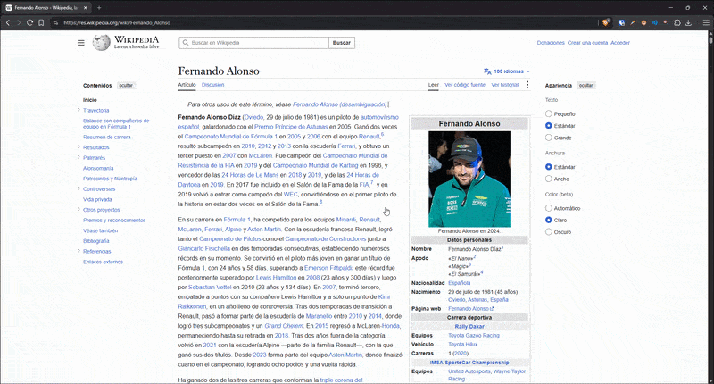

# Image Viewer Chrome Extension


A lightweight, local-first, highly secure Chrome and Brave extension to inspect images comfortably in an isolated overlay without page distractions.

## Features

- **Contextual Inspection**: Right-click any image and select "Open with Image Viewer".
- **Advanced Navigation**: Smooth zooming (mouse wheel or controls) and panning (drag mechanics).
- **DOM Isolation**: Powered by a Closed Shadow DOM, preventing host website style bleeding.
- **Privacy & Security**: Zero trackers, zero analytics, zero external API requests. Local-first implementation requesting minimal permissions.
- **Customizable UI**: Adjustable backdrop opacity, zoom sensitivity, keyboard shortcuts, and more via settings.
- **Fullscreen Support**: Toggle fullscreen mode for immersive viewing.
- **Rotation Controls**: Rotate images 90° left or right with keyboard shortcuts (Q/E) or buttons.
- **HUD Toggle**: Hide or show the heads-up display (HUD) for a distraction-free experience.

## How to Use

  
*Replace this image with your own demo GIF or screenshot*

1. **Activate**: Right-click on any image and select "Open with Image Viewer" from the context menu.
2. **Navigate**:
   - **Zoom**: Use mouse wheel, zoom buttons, or `+` / `-` keys
   - **Pan**: Click and drag the image, or use arrow keys
   - **Rotate**: Use rotation buttons or `Q` (counter-clockwise) / `E` (clockwise) keys
   - **Reset**: Press `R` or click the reset button to return to original zoom and position
   - **Fullscreen**: Press `F` or click the fullscreen button
   - **Hide HUD**: Press `H` or click the hide HUD button to hide controls
   - **Close**: Press `Esc` or click the close button

## Installation & Local Development

### Prerequisites

- Node.js (v20+)
- npm

### 1. Build the Extension

In your project directory, install dependencies and compile the assets:

```bash
npm install
npm run build
```

Alternatively, to start Vite's watch mode for active development:

```bash
npm run dev
```

### 2. Load into Chrome / Brave

1. Open your browser and navigate to `chrome://extensions/` or `brave://extensions/`.
2. Enable **Developer mode** using the toggle switch in the top-right corner.
3. Click **Load unpacked** in the top-left corner.
4. Select the `dist/` directory inside this project's folder.

## Testing & Quality Control

### Unit Tests

Core math calculations (zoom, pan, coordinates, limits) are tested with **Vitest**:

```bash
npm run test:run
```

### Linting & Formatting

Verify code quality and style guides:

```bash
npm run lint
npm run format
```

### Type Checking

Ensure TypeScript types are correct:

```bash
npm run typecheck
```

## License

This project is licensed under the MIT License - see the [LICENSE](LICENSE) file for details.

## Contributing

Contributions are welcome! Please feel free to submit a Pull Request. For major changes, please open an issue first to discuss what you would like to change.

1. Fork the repository
2. Create your feature branch (`git checkout -b feature/AmazingFeature`)
3. Commit your changes (`git commit -m 'Add some AmazingFeature'`)
4. Push to the branch (`git push origin feature/AmazingFeature`)
5. Open a Pull Request

---

I needed zoom.